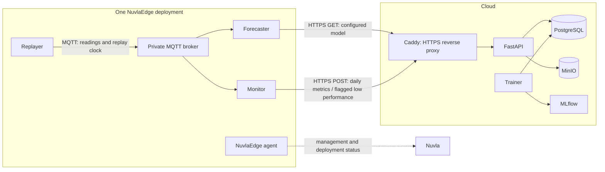

# Edge deployment

`Dockerfile` packages the existing replayer, forecaster, and monitor with the
immutable course kit and data. The image runs the kit verification during the
build and must be built for `linux/amd64`.

The Nuvla application recipe is `compose.nuvla.yaml`. It expects Nuvla input
parameters for `DEVICE_IDS`, `API_URL`, `DEVICE_TOKENS_JSON`,
`MODEL_VERSION_CONS`, `MODEL_VERSION_PROS`, `REPLAY_START`, `REPLAY_END`,
and `REPLAY_SPEED`.
The recipe includes a private MQTT broker for the three services, so it works
even when the optional NuvlaEdge Data Gateway is disabled. It does not publish
ports or receive cloud connections.

The image is intentionally usable as a preloaded local image. This permits a
first deployment without a Docker registry: build it once, transfer it to each
private edge VM, and let Nuvla manage the Compose lifecycle. A registry-backed
tag can replace the local image without changing the recipe.

## Deployment to NuvlaEdge

Deploy the cloud API first; see [cloud/README.md](../cloud/README.md) for its
public API hostname and private service access.

The current fleet consists of five private SWITCH Engine VMs. They are managed
from the Nuvla group `TSM-CloudSys-09`; the cloud VM is the SSH jump host. Each
VM must have Docker Engine and the NuvlaEdge agent commissioned in that group.
Nuvla generates the device credentials during commissioning. The NuvlaEdge
agent runs on the host with Docker-socket access so it can manage applications.

### Build and load the edge image

Run from the root of `cloudsys-p4-group09`. The course checkout must be the
sibling `cloudsys-p4-students-main` directory, or adjust the build context:

```sh
docker buildx build --platform linux/amd64 \
  --build-context materials=../cloudsys-p4-students-main \
  -f edge/Dockerfile \
  -t p4-group09-edge:2026-11-02 --load .
docker save -o /tmp/p4-group09-edge.tar p4-group09-edge:2026-11-02
```

The image is not published to a registry. Copy the archive to each private VM
through the cloud jump host, then load it locally. Replace `<EDGE_PRIVATE_IP>`
with that VM's private address:

```sh
scp -i ~/.ssh/p4_group09_cloud \
  -o 'ProxyCommand=ssh -i ~/.ssh/p4_group09_cloud -W %h:%p ubuntu@86.119.46.71' \
  /tmp/p4-group09-edge.tar ubuntu@<EDGE_PRIVATE_IP>:/tmp/
ssh -i ~/.ssh/p4_group09_cloud \
  -o 'ProxyCommand=ssh -i ~/.ssh/p4_group09_cloud -W %h:%p ubuntu@86.119.46.71' \
  ubuntu@<EDGE_PRIVATE_IP> 'sudo docker load -i /tmp/p4-group09-edge.tar'
```

Confirm the tag exists on the VM before starting the Nuvla deployment:

```sh
ssh -i ~/.ssh/p4_group09_cloud \
  -o 'ProxyCommand=ssh -i ~/.ssh/p4_group09_cloud -W %h:%p ubuntu@86.119.46.71' \
  ubuntu@<EDGE_PRIVATE_IP> 'sudo docker image ls p4-group09-edge'
```

### Configure and start the Nuvla application

In Nuvla, switch to **TSM-CloudSys-09**. Select the per-edge `P4 Group 09 Edge`
application and target the matching commissioned NuvlaEdge. Provide these
environment variables for that edge:

| Variable | Value |
|---|---|
| `DEVICE_IDS` | The two meter IDs assigned to this edge, comma-separated |
| `DEVICE_TOKENS_JSON` | JSON containing only those meters' tokens from `cloud/.env` |
| `API_URL` | `https://<API_HOSTNAME>` from the cloud `.env` (no `/v1` suffix) |
| `MODEL_VERSION_CONS`, `MODEL_VERSION_PROS` | Published model versions, initially `1` |
| `REPLAY_START`, `REPLAY_END` | Inclusive start and exclusive end dates for the replay |
| `REPLAY_SPEED` | Replay speed; `1440` means one simulated day per minute |

Keep the token values private; do not commit them or include them in screenshots
or recordings. Start the deployment from Nuvla. The Compose project starts a
private MQTT broker, replayer, forecaster, and monitor. It publishes no ports;
the monitor and forecaster make outbound HTTPS requests to the cloud API.

### Edge-to-cloud communication

Replay readings and forecasts use MQTT only inside the edge's private Compose
network. The edge does not expose an application port, and the cloud does not
connect directly to the edge services. The monitor and forecaster initiate
outbound HTTPS connections to the public cloud API through Caddy on TCP port 443.



The monitor and forecaster authenticate to the API with the bearer token for
each meter, taken from that edge's `DEVICE_TOKENS_JSON` value. The forecaster
downloads configured model versions from `GET /v1/models/{category}/{version}`.
The monitor posts daily evaluations to `POST /v1/metrics`; it posts a detailed
batch to `POST /v1/lowperf` only when low performance is flagged. Failed posts
are kept in the edge's persistent outbox and retried. Caddy forwards these
`/v1/*` requests to FastAPI; the edge does not connect directly to PostgreSQL,
MinIO, or MLflow. The cloud trainer reads stored results from PostgreSQL and
records training runs in MLflow.

The NuvlaEdge agent has a separate management channel to Nuvla for device status
and application deployment. It does not carry meter readings or forecasts. The
application data flow is edge-initiated and requires no inbound cloud connection
to the edge VM.

The current deployment uses five private app definitions named
`P4 Group 09 Edge 1 v2` through `P4 Group 09 Edge 5 v2`. Each app contains only
its assigned meter pair and tokens. Nuvla snapshots the app definition in each deployment.
After changing the Compose recipe, create a new module definition at a new path,
assign it to the deployment, and then restart it; editing the source app alone
does not update an existing deployment snapshot.

### Verify and operate

Switch the Nuvla dashboard to `TSM-CloudSys-09`. It should show five edges and
five started deployments. On a target VM, verify its containers with:

```sh
sudo docker ps --format '{{.Names}}  {{.Status}}'
```

The container names begin with the Nuvla deployment UUID and end with the
service name (`mqtt`, `replayer`, `forecaster`, or `monitor`). To watch live
replay messages, inspect the MQTT container logs on that VM:

```sh
sudo docker logs --tail 20 -f <DEPLOYMENT_ID>-mqtt-1
```

The replayer exits when its selected data interval is complete; the MQTT broker,
forecaster, and monitor remain running. Restarting the Nuvla deployment starts
the replay interval again. The named `edge_state` volume persists forecaster
history and its outbox, so do not remove volumes unless intentionally resetting
that edge's state.
